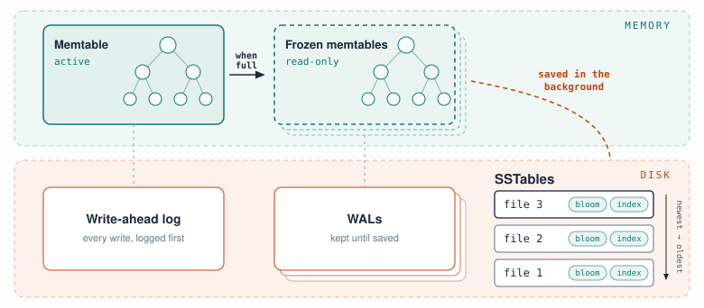

# LSM Tree Key-Value Store

A Log-Structured Merge Tree (LSM Tree) key-value store written from scratch in Go, exposed over a small REST API.

- **Write:** through an fsync'd write-ahead log into an in-memory memtable; frozen memtables flush to immutable SSTables in the background
- **Read:** memtables first, then SSTables newest-to-oldest, using sparse indexes and bloom filters to skip disk work
- **Recovery:** WALs are replayed on startup, so no acknowledged write is lost



## Run & Test

```sh
go run main.go   # serves on :8080  

curl -X PUT localhost:8080/foo -d "bar"
curl localhost:8080/foo
curl -X DELETE localhost:8080/foo
```

## Roadmap

This roadmap comes out of a source-level study of production LSM engines (goleveldb, Pebble, Badger, Cassandra, ScyllaDB), comparing how each one solves the same problems and adapting the ideas that fit a small educational engine. Most items follow the LevelDB lineage as realized in Pebble.

Ordered by dependency: earlier items unblock later ones.

1. **Foundations**
   - [x] Byte-based memtable threshold (count bytes, not entries)
   - **Skiplist memtable** (replaces the AVL tree)
     - [x] Single-threaded skiplist behind `MemTableImplementation` (Pugh's insert, p=1/4)
     - [ ] Arena-backed nodes (one allocation, exact accounting)
     - concurrent access lives in §6, not here
   - [ ] CRC checksums on WAL records and SSTable blocks (independent, can be done any time)
2. **SSTable format**
   - [ ] Serialize the bloom filter and sparse index (`ToBytes`/`FromBytes`)
   - [ ] Footer pointing at filter + index blocks; open reads footer instead of scanning
   - [ ] Keep SSTables open (persistent reader per table)
3. **Read path**
   - [ ] Iterator stack: per-block → per-table → merging iterator
   - [ ] Hot-metadata caching (index/filter blocks)
   - [ ] Measure read amplification
4. **Maintenance**
   - [ ] Minimal manifest (atomic install/remove of files)
   - [ ] Compaction, then a 2-level shape
   - [ ] Measure write/space amplification
   - [ ] Crash-injection tests
5. **MVCC**
   - [ ] Sequence numbers in the internal key (overwrite becomes insert, drops `oldValueLen` in the memtable)
   - [ ] Atomic batches as the WAL unit
   - [ ] Snapshots + snapshot-pinned scans
6. **Concurrency** (one package, starts after §5)
   - [ ] Group commit: writer queue with a leader, fsync out from under the mutex
   - [ ] Lock-free memtable readers (single writer, atomic pointer publication)
   - [ ] Concurrent memtable writers (CAS skiplist + published-seqnum watermark)
